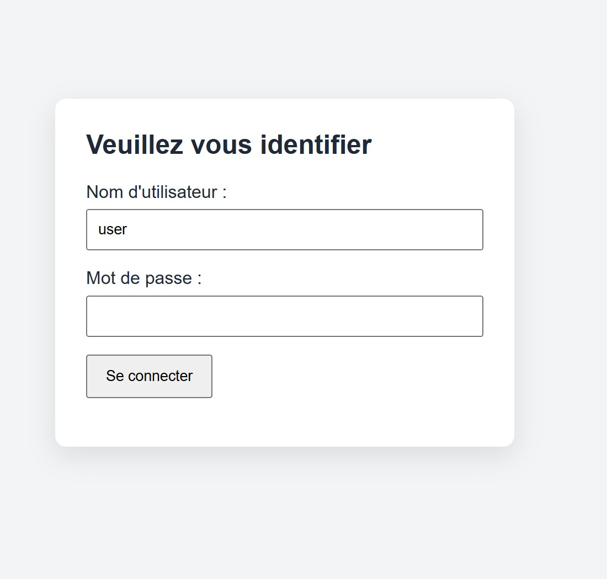
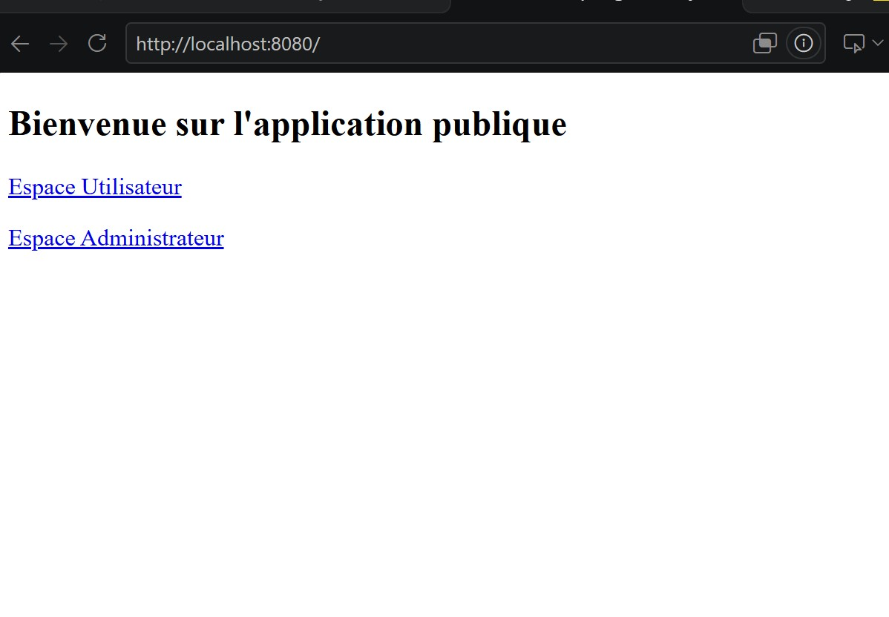
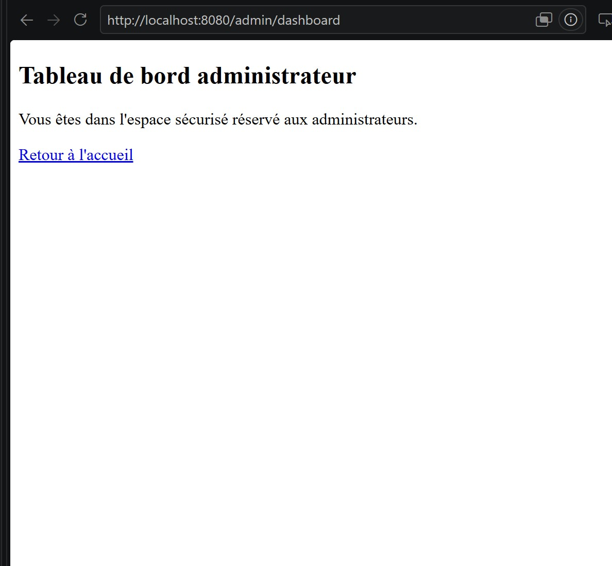

# Démo Spring Security

## Connexion

La page de connexion permet de saisir un nom d'utilisateur et un mot de passe.

## Accueil

La page d'accueil publique propose des liens vers les espaces utilisateur et administrateur.

## Espace administrateur

Le tableau de bord administrateur est accessible avec un compte qui possède le rôle ADMIN.

